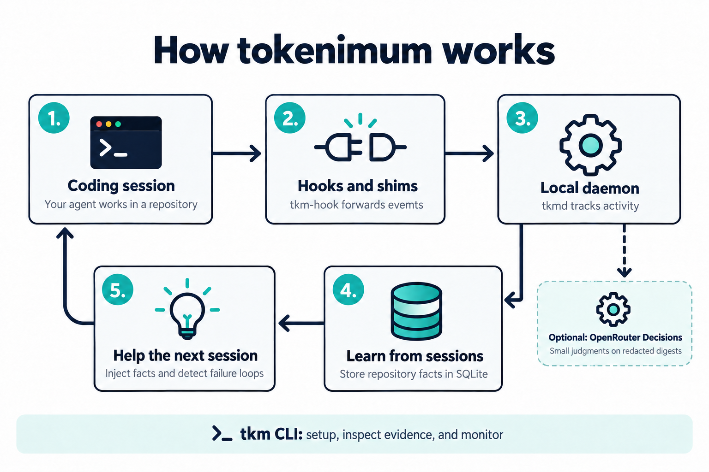

# tokenimum

**Help coding agents remember your project and waste fewer tokens.**

tokenimum learns from coding sessions in a repository. It saves useful facts, brings them into
later sessions, detects repeated failure loops, and proposes removing tools the project does
not use. For example, an agent can learn that this repository needs `python -m pytest` instead
of `pytest`, rather than rediscovering the same fix each session.

This is an early preview. The CLI, daemon, eight host adapters, and offline tests are implemented;
real-world token savings and live decision-model quality have not yet been established.
See the [implementation status and known gaps](docs/spec-conformance.md).

[Install](#installation) · [Use it in a project](#use-it-in-a-project) ·
[Benchmarks](#benchmarks) · [Contributing](CONTRIBUTING.md)

## How it works



1. **Observe a session.** A host hook or shim sends events through `tkm-hook` to the local
   daemon, `tkmd`. The daemon tracks tool calls and reads supported session logs.
2. **Learn about the repository.** Completed and idle sessions are folded into evidence:
   useful commands, repository facts, recurring failures, and tool usage. SQLite stores this
   state locally, with facts scoped to the repository.
3. **Help the next session.** tokenimum supplies relevant facts, detects failure loops, and
   proposes tool pruning. Available actions depend on the host and preset. New repositories
   need session evidence before there is anything useful to reuse.
4. **Inspect the result.** Use `tkm` to see status, facts, decisions, and the evidence behind
   an action. The terminal monitor shows activity as it happens.

Optional OpenRouter Decisions requests judge small questions using redacted digests. The
`offline` preset disables these requests and keeps code-based evidence and deterministic
rules. Offline mode applies to tokenimum; your coding agent still uses its own model service.

### Supported coding agents

| Agent | Integration |
| --- | --- |
| Claude Code | Native hooks |
| Codex | Native hooks |
| Antigravity (`agy`) | Native hooks |
| Cursor | Native hooks |
| Kimi Code | Native hooks; event output capabilities vary |
| DeepSeek harness (Codewhale) | Native hooks |
| opencode | TypeScript plugin shim |
| Pi | TypeScript extension shim |

Host capabilities differ; native hooks do not imply that every host supports every action.
With shims disabled, opencode and Pi use session-log folding and instructions instead of live
interception. See [host verification](docs/verified/e5b-hosts.md) and
[opencode/Pi integration details](docs/verified/opencode-pi.md).

## Prerequisites

- **Linux x86_64 or ARM64** for the downloadable release binaries. They are statically linked;
  Rust and a system musl installation are not required.
- At least one supported coding agent, installed and initialized under your user account.
- A project checkout. Run repository-specific commands from inside that project.
- For the installation commands below: Bash, `tar`, `sha256sum`, `install`, and the
  [GitHub CLI](https://cli.github.com/). Authenticate `gh` with an account that can access this
  repository; it is currently private.
- Optional: an OpenRouter API key for model-assisted decisions. Start offline without a key.

The daemon uses a user service when available and can fall back to a detached process.
It does not require root. macOS service support exists in the source, but this release ships
Linux archives only.

## Installation

Download the initial preview, verify both the archive and binaries, and install all three
executables. Run this in a new directory:

```bash
case "$(uname -m)" in
  x86_64) target=x86_64-unknown-linux-musl ;;
  aarch64|arm64) target=aarch64-unknown-linux-musl ;;
  *) echo "Unsupported architecture" >&2; exit 1 ;;
esac
archive="tokenimum-${target}.tar.gz"
gh release download v0.0.0 --repo datamonsterr/tokenimum \
  --pattern "$archive" --pattern "$archive.sha256"
sha256sum -c "$archive.sha256"
tar -xzf "$archive"
sha256sum -c SHA256SUMS
mkdir -p "$HOME/.local/bin"
install -m755 tkm tkm-hook tkmd "$HOME/.local/bin/"
export PATH="$HOME/.local/bin:$PATH"
tkm --help
```

Add `~/.local/bin` to `PATH` in your shell startup file to keep it available in new terminals.
Release assets and checksums are listed on the [releases page](https://github.com/datamonsterr/tokenimum/releases).
For build provenance and publication details, see the [release guide](docs/release.md).

## Use it in a project

Open a terminal inside your project checkout. Preview the changes, then install using the
offline preset:

```bash
tkm init --dry-run --preset offline
tkm init --yes --preset offline
tkm doctor
tkm status
```

`init` detects agent homes and shows which configuration files it will change. It installs the
selected integrations and daemon service. Restart your coding agent after installation, then
work normally in the project. `doctor` checks daemon and integration health; a failed check
includes a diagnostic to investigate.

To select one agent, use its short name. For example, for an initialized Claude Code home:

```bash
tkm init --yes --only claude --preset offline
```

Other names are `codex`, `agy`, `cursor`, `kimi`, `deepseek`, `opencode`, and `pi`.
Use `tkm init --help` for custom agent homes and other installation options.

### Inspect what it learned

```bash
tkm status
tkm facts --brief
tkm prune
tkm config show --effective
tkm export > tokenimum-state.json
```

These commands report the current repository. A fresh installation may have no facts,
proposals, or actions yet. `export` omits stored argument/output digests by default.

After an action has been recorded, inspect its evidence:

```bash
tkm why last
```

This returns exit code 1 with an `unknown action event` message if there is no action yet.

For a live view, run this in an interactive terminal; press `q` to quit:

```bash
tkm top
```

### Choose a preset

| Preset | Behavior |
| --- | --- |
| `offline` | No decision-model requests; code evidence, deterministic rules, pruning proposals |
| `observe` | Collect evidence and report proposals; suppress fact injection and use shadow loop decisions |
| `balanced` | Default thresholds and evidence gates for facts, loop handling, and pruning |
| `aggressive` | Lower fact-confirmation threshold and allow pruning application, subject to protection rules |

To change the global preset:

```bash
tkm config preset offline
```

For model-assisted decisions, run interactive setup and choose a key source, then select
`balanced`. Setup can read `OPENROUTER_API_KEY`, reuse a key file, or accept hidden key entry.
Model actions require their configured evidence and calibration gates; adding a key does not
immediately authorize every action. Neither `observe` nor `balanced` is an offline preset.

The web dashboard requires a daemon built with the optional `web` feature. The preview
archives use the default build, so use `tkm top` with those binaries.

### Configuration and local data

On Linux, defaults are:

| Location | Purpose |
| --- | --- |
| `~/.config/tokenimum/config.toml` | User configuration |
| `.tokenimum.toml` in your project | Shared project configuration |
| `.tokenimum.local.toml` in your project | Local project overrides |
| `~/.local/share/tokenimum/tokenimum.db` | SQLite evidence and session state |
| `~/.local/share/tokenimum/errors.log` | Error log |

XDG directory overrides are supported. Configuration layers run from defaults and presets to
user, project, local-project, environment, and invocation flags. Some settings are restricted
at project scope. `tkm config show --effective` shows the resolved values and their sources.

Session state stays on your machine. If you enable decision models, tokenimum sends redacted
summaries to OpenRouter. Review [data handling](SPEC.md#84-request-rules) before enabling them.
superorchestrator and otherskill integrations are optional and activated when detected.

### Uninstall integrations

Stop the `tkmd` user service or detached process first. A running detached daemon prevents
complete removal; the CLI reports how to stop it. Preview removal, then remove tokenimum-owned
integration entries:

```bash
tkm uninstall --dry-run
tkm uninstall
```

See `tkm uninstall --help` to limit removal to one host.

## Benchmarks

The [main-branch benchmark run from October 30, 2026](https://github.com/datamonsterr/tokenimum/actions/runs/41000421547)
measured the following at commit `16ca349` on the `namespace-profile-linux-xl` CI runner:

| Measurement | Result | Method |
| --- | --- | --- |
| Native hook → daemon round trip | p50 **1.609 ms**, p99 **1.880 ms** | 500 runs after 20 warmups; recorded Claude tool event; decisions disabled |
| opencode shim round trip | p50 **7.702 ms**, p99 **9.833 ms** | Bun shim benchmark against a running daemon |
| Pi shim round trip | p50 **6.464 ms**, p99 **7.668 ms** | Bun shim benchmark against a running daemon |
| Daemon tool-event handling | **2.916–12.932 µs** | Three Criterion cases; excludes process startup |
| Fold a Claude fixture session | **8.417 ms** | Criterion; synthetic fixture data |
| Render a terminal-monitor pane | **0.086–0.398 ms** | Six Criterion cases |

These measure overhead on one runner, not token savings or live model latency. Results vary
by hardware, session size, and host. CI enforces native-hook p50 below 3 ms and p99 below 10 ms,
plus per-operation budgets and a 20% regression gate when a main baseline is available.

Run the deterministic decision benchmark from this repository checkout, without an API key:

```bash
tkm replay --bench fixtures/bench
```

The committed [decision report](docs/reports/m0-decision-bench.md) uses **synthetic model
responses**. Its agreement, latency, and costs validate benchmark plumbing; they do not measure
production models. No representative end-to-end token-saving percentage is available yet.
The [replay benchmark plan](docs/plan/replay-benchmark.md) describes the controlled comparison.

For performance reproduction, use the repository's
[Bench workflow](.github/workflows/bench.yml). Contributor builds, tests, and benchmarks run
in GitHub Actions under the [contribution rules](CONTRIBUTING.md).

## Development and reference

- [Specification](SPEC.md) and [architecture decisions](docs/adr/)
- [Implementation status](docs/spec-conformance.md) and [delivery plan](docs/plan/EPICS.md)
- [README verification record](docs/verified/readme.md)
- `crates/tkm-cli`, `crates/tkm-hook`, `crates/tkmd`: CLI, hook client, daemon
- `crates/tkm-core`, `crates/tkm-store`, `crates/tkm-hosts`: policies, storage, host adapters
- `fixtures/`, `scripts/`: offline fixtures and validation tools

## License

[Apache-2.0](LICENSE). See [NOTICE](NOTICE) for attribution, including the
microsoft/TokenEconomizer design origin.
